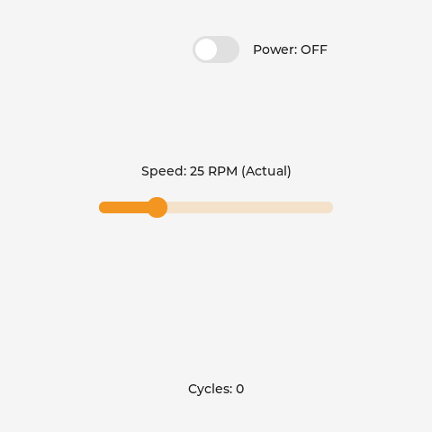
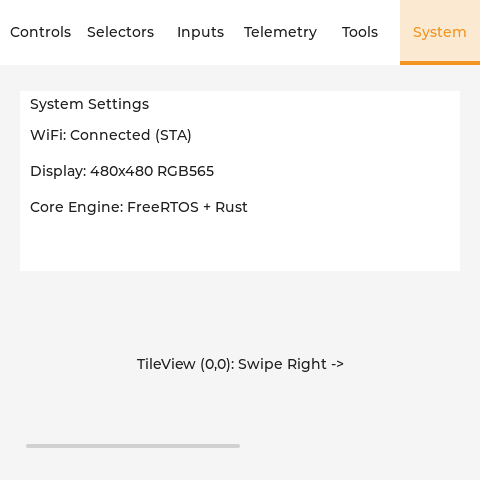

# Application Examples & Starter Templates

The framework includes reference applications and starter templates under the [`examples/`](file:///home/thughes/git/esp32-rust-lvgl-framework/examples) directory:

| Example | Path | Key Highlights | Target |
|---|---|---|---|
| **Minimal Starter** | [`examples/minimal/`](file:///home/thughes/git/esp32-rust-lvgl-framework/examples/minimal) | Cleanest starting point for a new project. 3 widgets, custom `ParamId`s, minimal worker loop. | Any ESP32 SoC |
| **Everything Example** | [`examples/everything/`](file:///home/thughes/git/esp32-rust-lvgl-framework/examples/everything) | Complete showcase covering all 25 supported LVGL widgets across 6 tabs with virtual keyboard, oscilloscope charts, calendar, keypad matrix, canvas, and 60s screensaver timeout. | Guition ESP32-S3-4848S040 |

---

## 1. Minimal Starter Example (`examples/minimal`)

The **Minimal Starter Example** provides a self-contained template for developers starting a new application. It demonstrates the complete end-to-end flow in under 150 lines of Rust and 70 lines of C.

### Declaring Custom Parameter IDs
Instead of hardcoding enums in the library, your application defines custom IDs using the open `ParamId` newtype:

```rust
// examples/minimal/crates/minimal-app/src/lib.rs
pub const PARAM_POWER: ParamId   = ParamId::new(101);
pub const PARAM_SPEED: ParamId   = ParamId::new(102);
pub const PARAM_COUNTER: ParamId = ParamId::new(103);
```

### Declaring the UI Schema in Pure Static Rust
```rust
pub static MINIMAL_SCHEMA: &[WidgetDescriptor] = &[
    WidgetDescriptor::switch(
        PARAM_POWER,
        UiAlign::TopMid,
        0, 40,
        c"Power: ON",
        c"Power: OFF",
    ),
    WidgetDescriptor::slider(
        PARAM_SPEED,
        UiAlign::Center,
        0, -10,
        0, 100, 25,
        500, // 500ms arbitration holdoff lease
        c"Speed: %ld RPM (Setting)",
        c"Speed: %ld RPM (Actual)",
    ),
    WidgetDescriptor::label(
        PARAM_COUNTER,
        UiAlign::BottomMid,
        0, -40,
        c"Cycles: %ld",
    ),
];
```

### Visual Layout
The minimal starter application initializes a clean 3-widget control loop on the display:

<div align="center">
  
  <p><em>Minimal Starter Layout: Power Switch (TopMid), Speed Slider with 500ms arbitration holdoff (Center), and Cycle Counter (BottomMid).</em></p>
</div>


### Implementing the State Machine & Control Loop
```rust
impl MinimalEngine {
    pub fn process_command(&mut self, cmd: &UiCommand) {
        self.active_seq_id = cmd.seq_id;
        match cmd.param_id {
            PARAM_POWER => self.is_powered = unsafe { cmd.value.bool_val },
            PARAM_SPEED => self.target_speed = unsafe { cmd.value.i32_val },
            _ => {}
        }
    }

    pub fn step(&mut self) {
        if self.is_powered {
            self.cycle_count = self.cycle_count.wrapping_add(1);
            if self.current_speed < self.target_speed {
                self.current_speed += 1;
            } else if self.current_speed > self.target_speed {
                self.current_speed -= 1;
            }
        }
    }
}
```

### C Application Entrypoint (`main.c`)
```c
// examples/minimal/main/main.c
void app_main(void) {
    bridge_transport_init(32, 64);

    // Core 0: Rust closed-loop worker (50 Hz)
    xTaskCreatePinnedToCore(rust_worker_task, "rust_worker", 8192, NULL, 5, NULL, 0);

    // Core 1: LVGL GUI & touch loop
    xTaskCreatePinnedToCore(lvgl_ui_task, "lvgl_task", 8192, NULL, 5, NULL, 1);
}
```

### Building the Minimal Starter
```bash
# Using the root Makefile:
make build-minimal
make flash-minimal

# Or manually:
cargo build --release --target xtensa-esp32s3-none-elf -p minimal-app
cd examples/minimal
idf.py -DIDF_TARGET=esp32s3 build
idf.py -p /dev/ttyUSB0 flash monitor
```

---

## 2. Everything Reference App (`examples/everything`)

The **Everything** reference application showcases all 25 supported LVGL widgets across 6 tabs, running on the physical Guition ESP32-S3-4848S040 hardware:

### Key Capabilities

1. **6-Tab Scene Graph (All 25 Widgets Covered):**
   * **Tab 0 (Controls):** System Enable switch, LED indicator, activity spinner, arc knob, load progress bar, setpoint frequency slider with 3-stage arbitration, reset button, and cycle readout.
   * **Tab 1 (Selectors):** Mode dropdown, speed roller, and precision spinbox.
   * **Tab 2 (Inputs):** Dynamic virtual on-screen QWERTY keyboard with automatic focus retargeting between single-line command fields and multi-line notes areas.
   * **Tab 3 (Telemetry):** Real-time sine waveform streaming oscilloscope chart and multi-row system diagnostics status table (`Module`, `Status`, `Core 0`, `Core 1`, `PSRAM`).
   * **Tab 4 (Tools):** Maintenance Calendar date picker, 4×3 PIN security keypad matrix, and raw-pixel graphics Canvas.
   * **Tab 5 (System):** Hierarchical settings menu and swipeable tileview navigation.

2. **Power Management & Inactivity Lifecycle:**
   * **60s Inactivity Blanking:** Automatically shuts off the LED backlight (`bsp->set_backlight(0)`) after 60 seconds without touch events.
   * **Wake-on-Touch:** Tapping anywhere on the dark screen immediately restores full brightness (`bsp->set_backlight(100)`).
   * **Blind First-Tap Suppression:** Swallows the initial wake tap to prevent accidental clicks on background widgets.

3. **Anti-Jitter 3-Stage Arbitration:**
   * Monotonic sequence tickets (`seq_id`) protect interactive widgets during active touch dragging (`ARB_DRAGGING`) and temporal holdoff (`ARB_HOLDOFF`), completely eliminating telemetry rubber-banding and UI stutter.

### Visual Showcase (All 6 Tabs)

The reference application exercises all 25 supported LVGL widgets across 6 functional tabs, captured below from the headless test renderer:

| Tab 0: Controls | Tab 1: Selectors | Tab 2: Inputs |
|:---:|:---:|:---:|
|  |  |  |
| `Switch`, `Slider`, `Arc`, `Bar`, `Led`, `Spinner`, `Button`, `Label` | `Checkbox`, `Dropdown`, `Roller`, `Spinbox`, `Scale` | `TextInput`, `TextArea`, `Keyboard`, `MsgBox` |
| **Tab 3: Telemetry** | **Tab 4: Tools** | **Tab 5: System** |
|  |  |  |
| `Chart`, `Table`, `List` | `Calendar`, `ButtonMatrix`, `Canvas`, `Label` | `Menu`, `TileView` |

---

### Project Structure
```text
examples/everything/
├── CMakeLists.txt              # Standalone ESP-IDF project configuration
├── README.md                   # Detailed guide
├── main/
│   ├── CMakeLists.txt          # Links esp_lvgl_bridge, BSP, and everything-app
│   └── main.c                  # C task initialization, screensaver timer & scene graph
└── crates/
    └── everything-app/         # no_std Rust application logic
        ├── Cargo.toml
        └── src/lib.rs          # 25-widget Everything schema, SystemEngine & virtual keyboard wiring
```

### Building the Everything Example
```bash
# Using the root Makefile:
make build-everything
make flash-everything

# Or manually:
cargo build --release --target xtensa-esp32s3-none-elf -p everything-app
cd examples/everything
idf.py -DIDF_TARGET=esp32s3 build
idf.py -p /dev/ttyUSB0 -b 460800 flash monitor
```
