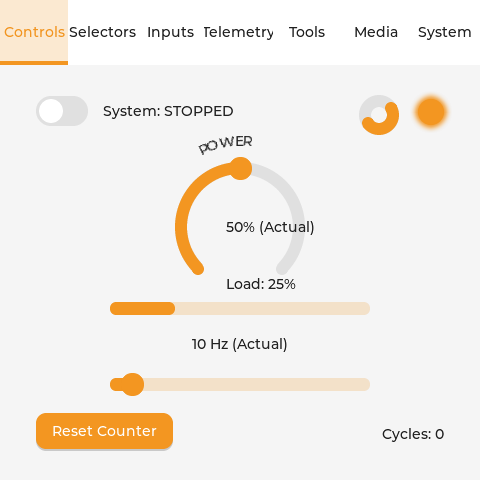
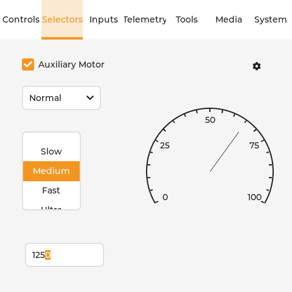
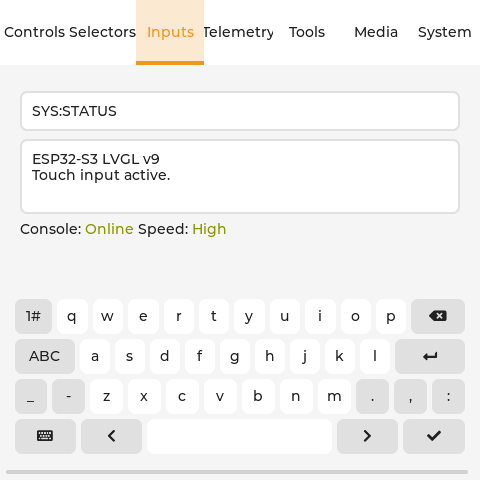
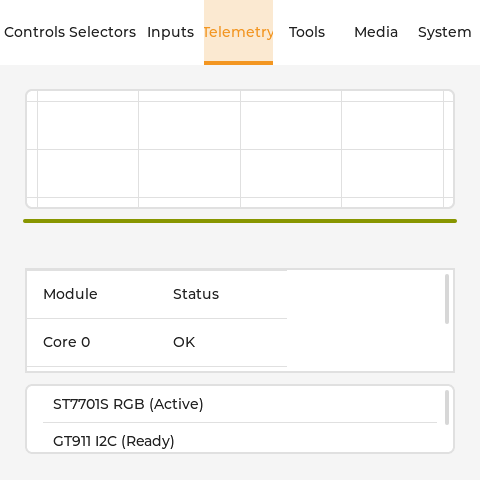
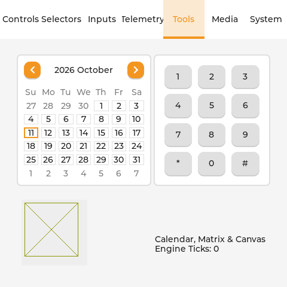
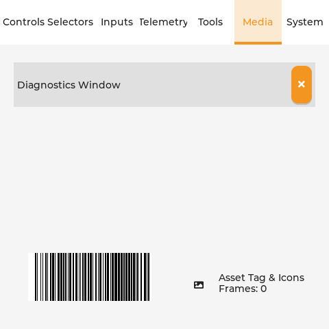
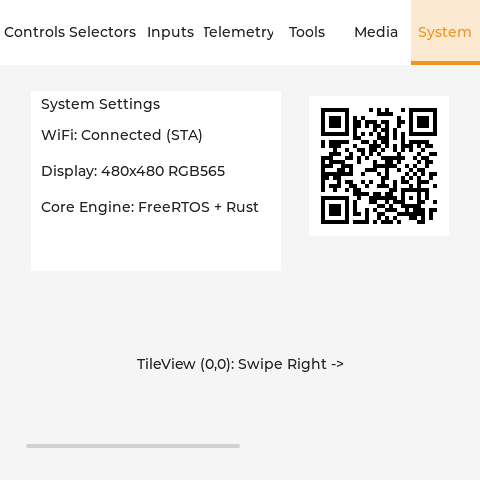

# Headless Visual QA Suite

The test suite runs entirely offscreen on host developer machines (Linux/macOS) without requiring hardware attached.

## How It Works
* **RGB888 In-Memory Canvas**: LVGL renders directly into an allocated buffer in host RAM.
* **Deterministic Virtual Time**: The test runner steps `lv_timer_handler()` with explicit virtual clock increments.
* **Synthetic Touch Injection**: Mouse/touch coordinates and press/release events are injected programmatically into the LVGL input device driver.
* **PNG Output**: After each UI scenario, frames are dumped directly to standard PNG images using `stb_image_write.h`.

## Running the Tests
```bash
cargo test --workspace
# Or using the top-level Makefile:
make test
```

## Test Execution Workflow
The test suite executes 4 structured testing phases:
1. **Phase 1: Headless Protocol & Engine Unit Assertions**:
   - `test_ffi_protocol`: Verifies POD struct sizing, union value conversions, string buffer safety, and ring buffer queue operations.
   - `test_p4_c6_link`: Verifies P4 <-> C6 loopback mock, packet framing, CRC16 checksum calculation, and sequence tracking.
   - `test_rust_state_engine`: Verifies closed-loop simulation (halted when stopped, incrementing when enabled, frequency scaling, and atomic resets).
   - `test_arbitration_engine`: Verifies 3-stage arbitration lease (`ARB_TRACKING` $\rightarrow$ `ARB_DRAGGING` $\rightarrow$ `ARB_HOLDOFF`), rejecting telemetry during drags and stale tickets during holdoffs.
2. **Phase 2: Everything 7-Tab Application Journey (`examples/everything`)**:
   - Programmatically asserts that all 34 supported LVGL widget types (`WidgetType::ALL`) are present in `EVERYTHING_SCHEMA`.
   - Exercises all 37 widget descriptors across all 7 tabs (Controls, Selectors, Inputs, Telemetry, Tools, Media, System).
   - Injects touch clicks on switches, checkboxes, buttons, and button matrices.
   - Drags sliders with 3-stage arbitration, streams real-time telemetry into progress bars, charts, and diagnostic tables.
   - Tests text entry into single-line and multi-line text areas.
   - Dumps high-resolution 480×480 PNG snapshots for every tab to `artifacts/`.
3. **Phase 3: Power Management & Inactivity Lifecycle**:
   - Verifies 60-second inactivity blanking (`bsp->set_backlight(0)`).
   - Verifies wake-on-touch restoration and blind first-tap suppression (ignoring the wake tap to prevent accidental clicks).

## Generated Visual Artifacts (artifacts/)

The headless test suite generates pixel-perfect 480×480 RGB888 snapshots for each of the 7 tabs in the **Everything** showcase application. These images are captured directly offscreen via `stb_image_write`:

| Snapshot | Tab | Widgets Covered |
|:---:|---|---|
|  | **Tab 0: Controls** | `Switch`, `Slider`, `Arc` (dial), `ArcLabel`, `Bar` (progress), `Led`, `Spinner`, `Button`, `ImageButton`, `Label` |
|  | **Tab 1: Selectors** | `Checkbox`, `Dropdown`, `Roller`, `Spinbox`, `Scale` (analog needle gauge), `AnimImage` |
|  | **Tab 2: Inputs** | `TextInput`, `TextArea`, `Keyboard` (auto-focusing QWERTY), `MsgBox` (modal), `SpanGroup` |
|  | **Tab 3: Telemetry** | `Chart` (streaming waveform), `Line`, `Table` (diagnostics matrix), `List` (interactive items) |
|  | **Tab 4: Tools** | `Calendar` (date picker), `ButtonMatrix` (4×3 keypad), `Canvas` (procedural graphics), `Label` |
|  | **Tab 5: Media** | `Win` (window modal), `Barcode` (asset tag), `Image` (symbol preview), `Label` |
|  | **Tab 6: System** | `Menu` (hierarchical settings drilldown), `QRCode` (WiFi credential matrix), `TileView` (2D swipeable navigation) |

